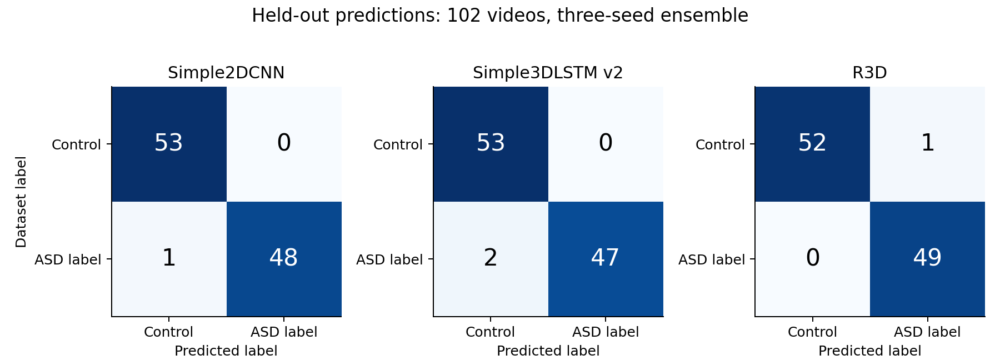
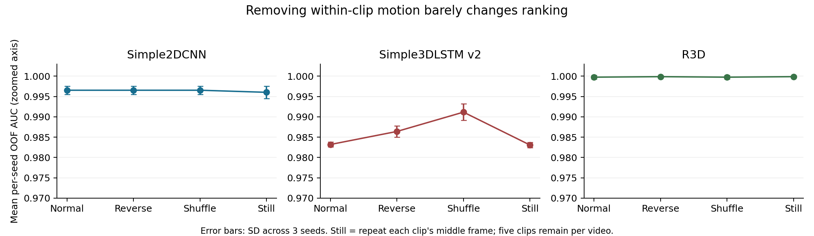
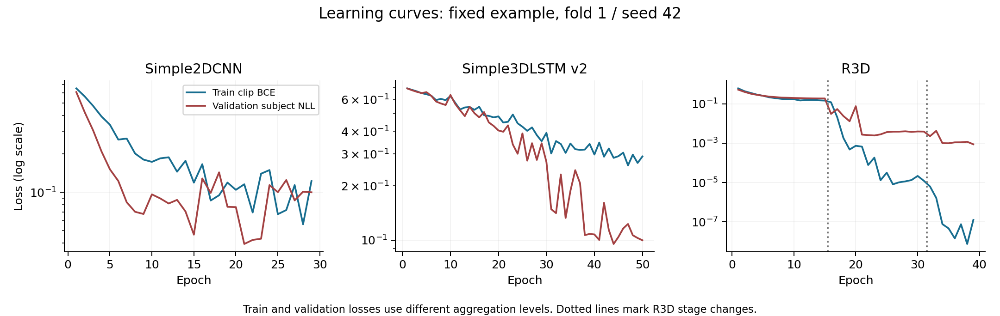
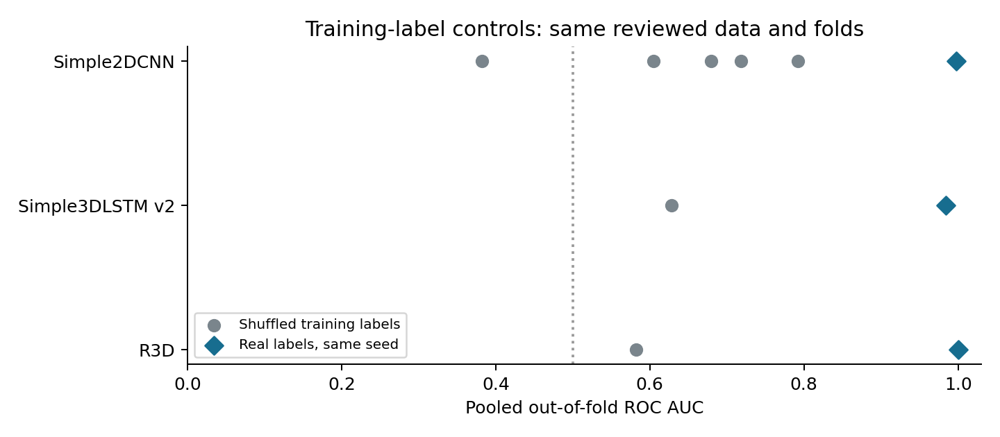

# Reviewed Subject Benchmark

## Participant Evidence

The dataset owner confirmed that each main participant appears in only one
video, and that assisting personnel can appear in frames. The private mapping
therefore assigns one pseudonymous participant and one participant-specific
recording session to each included video. This is owner-confirmed provenance;
it was not inferred from faces or filename timestamps.

The mapping passed full-file SHA-256 and identity validation: 107 included rows,
54 controls and 53 ASD-labeled videos. The original template was backed up in
the ignored private directory; provenance is recorded alongside the mapping.

## Decoding and Footage Review

- 108 raw files were inventoried.
- One originally unreadable file remains excluded.
- Five 16-frame clips at 15 FPS were attempted for each of 107 videos.
- Four additional videos failed the clip-reading policy: three ASD-labeled and
  one control. Two could not decode near a requested clip start; two exceeded
  the allowed fraction of substituted frames. All exclusions are recorded.
- The resulting cache contains 103 videos, with 53 control and 50 ASD labels.
- Whole-array hashes found no exact duplicate complete caches.
- The perceptual review nevertheless found one pair with 75 of 80 frames
  exactly equal, including four entire clips. The mean absolute pixel difference
  over all clips was 0.019733 on the 0-255 scale. Both recordings had label 1.
- One copy was excluded from an experiment-only manifest, retaining the first
  relative path lexically. Selection did not use model outcomes. Raw files and
  the original cache manifest remain intact.
- Final experiment sample: 102 videos, 53 controls and 49 ASD-labeled videos.
- Rechecking 510 representative frames after exclusion produced no cross-ID
  similarities above 0.98; maximum cosine similarity was 0.971780. This is a
  sampled footage review, not an exhaustive proof of uniqueness or identity.

Private evidence: `private/reviewed_cache_manifest.review.json` and
`runs/subject_confirmed_perceptual/review/`. These contain source references and
frames and must remain private.

## Protocol and Status

The reviewed manifest passed cache integrity and all five subject-fold checks.
Primary training completed for Simple2DCNN, Simple3DLSTM v2, and R3D using
seeds 42, 43, and 44. All 45 model/fold/seed runs completed successfully.
All 35 training-label control runs also completed, for 80 completed deep-model
runs in this pass. The controls use only training seed 42.

Simple models use at most 50 epochs with validation-NLL patience 8. R3D uses
15 head, 20 layer4, and 8 full-backbone epochs, with patience 8 per stage and
global checkpoint selection. Threshold is fixed at 0.5; temperature scaling is
disabled. All five cached clips are aggregated for evaluation. Normal, reversed,
shuffled, and repeated-middle-frame evaluations are predeclared.

```powershell
.\asd\Scripts\python.exe -u -m experiments.run_subject_benchmark --manifest private/reviewed_cache_manifest.csv --output_dir runs/subject_reviewed_benchmark --device cuda --wandb_mode disabled
```

Matching shortcut baselines are saved in `runs/subject_reviewed_shortcuts.json`.
Unreviewed 103-video intermediate audit outputs are retained only as provenance;
comparisons must use the 102-video reviewed dataset.

| Reviewed-cache baseline | ROC AUC | Bootstrap 95% CI | Balanced accuracy |
| --- | ---: | --- | ---: |
| Recording metadata | 0.903350 | 0.841731-0.951868 | 0.795726 |
| Color, brightness, padding | 0.891798 | 0.820158-0.951107 | 0.813824 |
| Frame-difference motion | 0.858683 | 0.766644-0.931854 | 0.831151 |
| Tiny thumbnails | 0.958028 | 0.905266-0.994609 | 0.951290 |

These use participant folds on corrected clips and a reviewed subset. The old
date-grouped audit used different frames, folds, and sample inclusion; changes
between the tables cannot be attributed to one correction alone.

## Primary Results

The following are pooled out-of-fold predictions averaged across three seeds
at the logit level. They describe a three-seed ensemble, not the average score
of a single trained model. Every participant was held out from the corresponding
fold's training and checkpoint selection.

| Model | Ensemble ROC AUC | Accuracy | Precision | Sensitivity | Specificity | F1 | NLL | Brier |
| --- | ---: | ---: | ---: | ---: | ---: | ---: | ---: | ---: |
| Simple2DCNN | 0.997305 | 0.990196 | 1.000000 | 0.979592 | 1.000000 | 0.989691 | 0.055115 | 0.013224 |
| Simple3DLSTM v2 | 0.983442 | 0.980392 | 1.000000 | 0.959184 | 1.000000 | 0.979167 | 0.143051 | 0.026058 |
| R3D | 1.000000 | 0.990196 | 0.980000 | 1.000000 | 0.981132 | 0.989899 | 0.015258 | 0.005485 |

| Model | Mean individual-seed OOF AUC +/- sample SD | Ensemble AUC bootstrap 95% CI | Epochs per run |
| --- | --- | --- | --- |
| Simple2DCNN | 0.996534 +/- 0.001019 | 0.989603-1.000000 | 23-50 |
| Simple3DLSTM v2 | 0.983186 +/- 0.000588 | 0.945707-1.000000 | 32-50 |
| R3D | 0.999743 +/- 0.000445 | 1.000000-1.000000 | 33-43 |

The R3D bootstrap interval is degenerate because resampling this already
perfectly ranked cohort cannot create new ranking errors. It does not establish
that population AUC is exactly 1.0, and none of these bootstrap intervals capture
all training, site, collection, or population uncertainty. R3D's one false
positive at the fixed 0.5 threshold is compatible with AUC 1.0: ranking and
thresholded classification measure different things.

R3D selected a full-backbone-stage checkpoint in 12 of 15 runs and a layer4-stage
checkpoint in 3. This describes validation selection; it is not a controlled
estimate of the causal benefit of stage 3. No thresholds or temperatures were
tuned on outer test data.



## Temporal Tests

| Model | Normal AUC | Reversed AUC | Shuffled AUC | Repeated-middle-frame AUC |
| --- | ---: | ---: | ---: | ---: |
| Simple2DCNN | 0.997305 | 0.997305 | 0.997305 | 0.996920 |
| Simple3DLSTM v2 | 0.983442 | 0.985753 | 0.990759 | 0.983442 |
| R3D | 1.000000 | 1.000000 | 1.000000 | 1.000000 |

These are ensemble scores. In the static condition, each of the five clips
repeats its own middle frame. It therefore removes within-clip motion while
retaining five still views from different moments in the video. R3D's shuffled
accuracy falls to 0.980392 while AUC remains 1.0. Reversal and shuffling are
expected to leave the temporal-average 2D architecture essentially unchanged.

The 3D models also retain almost all ranking performance without normal motion.
Together with the strong thumbnail baseline, this supports substantial static
visual discrimination. It does not establish which static features are used or
whether any are related to ASD rather than collection conditions.





The learning-curve examples use the first fold and seed, chosen for reproducible
inspection. Training clip loss and validation subject loss use different
aggregation levels and augmentations, so their difference is not a pure
generalization-gap estimate.

## Negative Controls and Inspection

The label-permutation suite completed with a fixed training seed 42:
five permutations for Simple2DCNN and one for each larger model, each across all
five folds (35 runs). Only training-subject labels are shuffled. Validation and
test labels remain unchanged. Every control uses the same reviewed manifest,
fold assignments, and model training protocol as its real-label comparator.
Metrics were recomputed from saved subject predictions, with held-out label and
coverage checks. Reconstructing the deterministic permutations changed
40.0%-64.6% of training labels per fold while preserving class counts.

| Model | Permutation seed | Control OOF AUC | Control accuracy | Control NLL | Real-label OOF AUC, seed 42 |
| --- | ---: | ---: | ---: | ---: | ---: |
| Simple2DCNN | 1042 | 0.679630 | 0.656863 | 0.658123 | 0.997690 |
| Simple2DCNN | 1043 | 0.604544 | 0.519608 | 0.652917 | 0.997690 |
| Simple2DCNN | 1044 | 0.718136 | 0.617647 | 0.661306 | 0.997690 |
| Simple2DCNN | 1045 | 0.792068 | 0.715686 | 0.603052 | 0.997690 |
| Simple2DCNN | 1046 | 0.381979 | 0.392157 | 0.699738 | 0.997690 |
| Simple3DLSTM v2 | 2042 | 0.628417 | 0.558824 | 0.669350 | 0.983827 |
| R3D | 2042 | 0.582210 | 0.529412 | 0.706832 | 1.000000 |

The five 2D control AUCs average 0.635271, with a wide 0.381979-0.792068
range. All controls perform worse than the corresponding real-label seed-42
run, but several remain appreciably above 0.5. These results must not be reduced
to a claim that the shuffle test passed at chance. In a small dataset, accidental
correlation between permuted and real labels can remain; checkpoint selection
still uses real validation labels and can favor models aligned with the real
task. These are possible explanations, not separately measured causal effects.

This is a training-label sanity control, not a formal permutation significance
test: true validation labels remain available to selection, and five or one
permutations do not characterize a precise null distribution. A future formal
test would need a separately specified exchangeability scheme and the complete
selection procedure included under that null. No p-value is claimed here.



The figure compares individual seed-42 results, not controls against a
three-seed ensemble. Full control metrics and reconstructed label-change counts
are in `docs/figures/reviewed_subject_benchmark/permutation_controls.json`.

Grad-CAM outputs for both target classes are generated from fold 1 / seed 42
on that fold's held-out videos, using the exact middle cached clip. R3D uses
`net.layer4`; both simple models use the final convolution `cnn.10`. These are
single-clip explanations, whereas primary predictions average all clips and
seeds. Frame images and participant references remain in ignored local outputs.

The overlay explicitly suppresses heatmap colors outside the content mask.
Consequently, a gray padding border in these pictures is not evidence that the
network ignores padding geometry. Zero-normalized padding still creates visible
content boundaries and preserves aspect-ratio cues. R3D's final-block map is
also coarse in space and time; it is not a pixel-precise attention measurement.

Local-only inspection links (the image files are intentionally not published):

| Model | Positive evidence | Negative evidence |
| --- | --- | --- |
| Simple2DCNN | [View](../gradcam_outputs/reviewed_subject/simple2dcnn_positive/index.html) | [View](../gradcam_outputs/reviewed_subject/simple2dcnn_negative/index.html) |
| Simple3DLSTM v2 | [View](../gradcam_outputs/reviewed_subject/simple3dlstm_v2_positive/index.html) | [View](../gradcam_outputs/reviewed_subject/simple3dlstm_v2_negative/index.html) |
| R3D | [View](../gradcam_outputs/reviewed_subject/r3d_positive/index.html) | [View](../gradcam_outputs/reviewed_subject/r3d_negative/index.html) |

Aggregate metrics and per-seed/ablation results:
`docs/figures/reviewed_subject_benchmark/reviewed_subject_metrics.json`.
All 80 selected checkpoint hashes were verified, and every fold/seed/ablation's participant
coverage and labels were rechecked against the archived fold assignments.

Final software checks at this stage: 79 tests run, 78 passed and one legacy
manifest test skipped; all 66 Python files passed AST parsing. All 1,008 image
references in the six Grad-CAM pages point to valid 112x112 files. Scientific
figures were rendered and visually inspected.

## Interpretation

With one video per confirmed participant, a correctly constructed video split
also separates those participants. The earlier concern that capture-date
overlap proved repeated participants was too strong: shared dates alone do not
establish participant overlap. They still permit shared backgrounds, personnel,
devices, and collection protocols across splits.

The near-identical recording pair was established from matching frame content,
not from identifying a person. Participant independence otherwise relies on the
owner's supplied information. The whole collection has previously been used in
development, so these remain internal validation estimates. No new external or
clinical validation is created by rebuilding the cache or changing the split.

## Correction Strategy

1. Keep this collection as development/internal validation data. Preserve these
   fixed results, seeds, and folds; do not tune on the inspected outer predictions.
2. Obtain new consented participants from collection conditions represented in
   both classes. Record participant, participant-session, site, device, and
   collection protocol explicitly. Balance or match these conditions by design.
3. Predeclare a new external evaluation before inspecting its labels or model
   scores. Freeze preprocessing, model selection, and the classification rule.
4. On development data, compare content-only/person-region and background-only
   inputs, plus source-held-out evaluations where both classes permit them.
   Keep those ablations exploratory; Grad-CAM alone cannot establish causality.
5. Retain the 2D and thumbnail baselines. The present temporal results do not
   justify claiming that a 3D network learned ASD-specific motion, or that its
   extra complexity is necessary.

The corrected pipeline is reproducible and substantially better audited. Its
remaining limitation is the evidence supplied by the dataset, not a reason to
keep increasing epochs until the already-inspected score improves.
